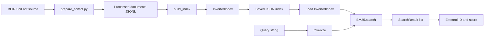

# Architecture

stratajanus currently implements the lexical retrieval path shown below.
Dataset preparation is optional when supplying your own documents in the
canonical format accepted by `build_index`.

## Dataset preparation

`download_scifact.py` downloads the BEIR source under `data/raw/scifact/`.
`prepare_scifact.py` validates the corpus, queries, and qrels and writes
processed JSONL/TSV files, a manifest, and `doc_ids.jsonl`. The manifest
records that IDs are assigned in zero-based corpus file order. The prepared
document schema has a string `doc_id`, `title`, and `text`, plus metadata.

Preparation is not part of `build_index`: callers may provide an ordered list
of canonical document dictionaries directly. The index builder uses the
title and body together, separated by a newline, and does not modify the
input dictionaries.

## Tokenizer

The default tokenizer first applies Unicode NFC normalization, then Python
lowercasing, then extracts non-overlapping matches of Unicode-aware `\\w+`.
Letters, digits, and underscores can appear inside a token; punctuation and
other non-word characters separate tokens. Repeated terms and occurrence
order are retained. Index and query strings use this same function.

`TokenizerConfig` records the schema version and analysis settings.
`save_tokenizer_config` writes the active settings as JSON, while
`verify_tokenizer_config` raises `ValueError` if a saved configuration differs.
`build_scifact_index.py` saves the inverted index, tokenizer configuration,
and manifest. `load_scifact.py` verifies the saved tokenizer settings and
reconstructs the index before searching.

## Inverted index and identifiers

`InvertedIndex` stores three aligned structures:

- `postings`: a mapping from token to a list of
  `(internal_id, term_frequency)` pairs.
- `doc_lengths`: token count for each internal ID, including zero for empty
  documents.
- `internal_to_external`: the original external `doc_id` at each internal
  ID position.

Internal IDs are zero-based positions assigned in document input order.
External IDs are caller-provided strings and are not used for posting order.
Each term appears at most once per document's posting list, with its count as
the second tuple element. Posting lists produced by `build_index` are in
ascending internal-ID order. Empty documents retain their IDs and lengths but
have no postings. Duplicate external IDs and malformed required fields raise
errors.

`document_frequency(term)` is the number of documents containing the exact
term, not the sum of its term frequencies. The average document length is the
mean of all document lengths and is `0.0` for an empty index.

## BM25 retrieval

`BM25` uses the Okapi BM25 sum with defaults `k1=1.2` and `b=0.75`. For each
distinct query token with postings, it computes

$$
\\operatorname{IDF}(t)=\\log\\left(1+\\frac{N-df(t)+0.5}{df(t)+0.5}\\right)
$$

and multiplies that by the term-frequency saturation and document-length
normalization contribution. Query tokens are generated by the same tokenizer,
deduplicated, and sorted before accumulation. Unknown terms contribute
nothing. An empty query, empty collection, all-zero-length collection, or
nonpositive `top_k` returns no results.

Results omit documents with score zero and sort by descending score, then
ascending internal ID. `SearchResult.score` is the computed ranking score, not
a probability or calibrated relevance estimate. Its `doc_id` is the external
ID and `internal_id` is the position used by the index and source document
list. If the index's public mutable structures are changed after constructing
the ranker, the cached collection statistics may no longer agree; treat the
index as read-only during ranking.

## Scope and future work

The implemented pipeline is lexical. The saved JSON index is uncompressed and
loaded into memory for retrieval. Dense or hybrid retrieval, benchmark metric
evaluation, reranking, RAG, and domain-specific financial analysis are not
implemented in the current package. They can be explored as future extensions
without implying that this codebase already provides them.
