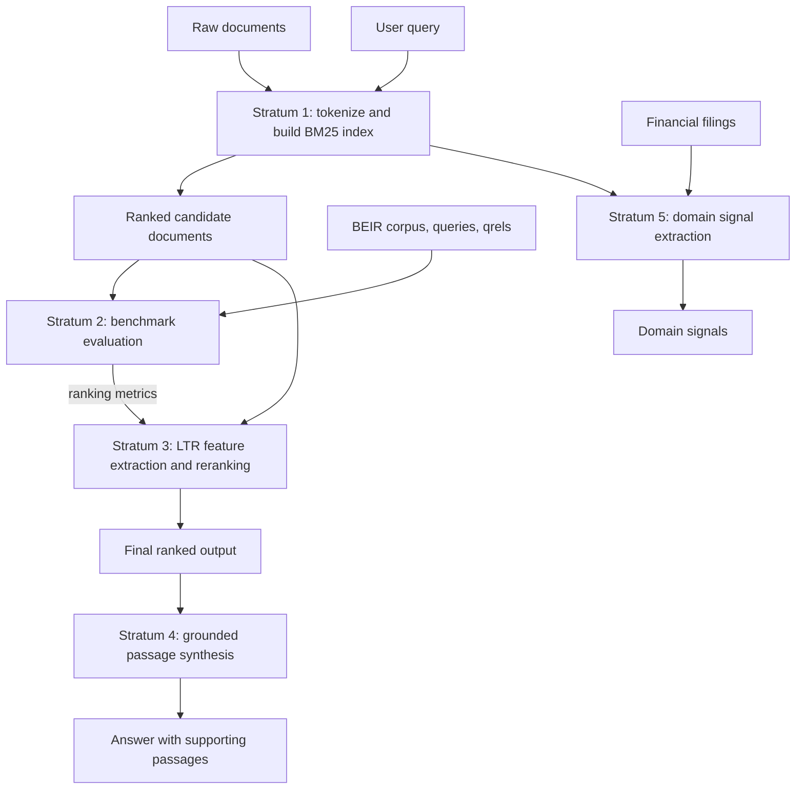

# Architecture: five strata, one retrieval pipeline

The engine separates candidate retrieval from later judgments and refinements. This is useful for learning because each stage has a clear input and output: a ranking algorithm can be changed without changing the dataset format, and an evaluator can compare systems using the same relevance labels.

In experiments, the benchmark is an evaluation path alongside retrieval: it measures rankings against human judgments. It does not normally sit in a live user's request path. The diagram shows the relationship between the components, not a claim that benchmark scoring must happen before reranking at query time.

## Stratum 1: core inverted index and BM25

### How it works

1. **Analyze text.** Normalize and split each document into terms. Tokenization choices matter: for example, whether `search-engine` is one token or two changes what can match.
2. **Build postings.** For every term, record the document IDs and term frequencies where it occurs. Also track document lengths and collection-level statistics.
3. **Analyze the query.** Apply compatible text processing to the user's terms.
4. **Score candidates.** Combine evidence from matching terms and sort documents by score.

An inverted index is like a book's index at the back: looking up a term takes you directly to the pages that mention it. BM25 improves on raw word counting by accounting for how informative a term is, how often it occurs, and how long its document is.

One common Okapi BM25 form is:

$$
\operatorname{BM25}(D,Q)=\sum_{t\in Q}\operatorname{IDF}(t)\cdot
\frac{f(t,D)(k_1+1)}{f(t,D)+k_1\left(1-b+b\frac{|D|}{\operatorname{avgdl}}\right)}
$$

Here $f(t,D)$ is the number of occurrences of query term $t$ in document $D$, $|D|$ is its length, and $\operatorname{avgdl}$ is the collection's average document length. A common IDF choice is $\log\left(1+\frac{N-n_t+0.5}{n_t+0.5}\right)$, where $N$ is the document count and $n_t$ is the number of documents containing $t$. Implementations may use slightly different IDF conventions.

!!! note "Concept: term saturation and $k_1$"
    Seeing a word twice is usually more useful than seeing it once, but seeing it 200 times rarely makes a document 200 times more relevant. $k_1$ controls how quickly this gain levels off. Larger values allow frequency to keep contributing for longer; smaller values saturate sooner.

!!! note "Concept: length normalization and $b$"
    A long document has more chances to contain any word. The $b$ parameter controls how much BM25 compensates for that. At $b=0$, length has no effect; at $b=1$, the full length adjustment is applied. Values between them are partial normalization.

## Stratum 2: benchmark suite

### How it works

BEIR-style data has three pieces: a **corpus** of documents, **queries**, and **qrels** (query relevance judgments). A qrel says how relevant a document is for a query, based on human annotation. The evaluator compares the system's ranked list with those judgments.

- **$NDCG@10$** (normalized discounted cumulative gain at 10) rewards placing highly relevant documents near the top. Relevance gains are discounted by rank, so a useful result at position 1 matters more than the same result at position 10. The score is normalized against an ideal ordering and is typically between 0 and 1.
- **Recall@k** asks what fraction of all known relevant documents appeared in the first $k$ results. If there are 10 known relevant documents and the top 5 contain 4 of them, Recall@5 is $4/10=0.4$.

!!! tip "Performance"
    Evaluate with the same query set and qrels when comparing rankers. Report the cutoff (such as 10) because $NDCG@10$ and $NDCG@100$ answer different questions about the ranking.

## Stratum 3: hybrid learning to rank

### How it works

BM25 is a strong lexical baseline, but word overlap does not capture every useful clue. A reranker can take the first-stage candidate list and build a feature vector for each query-document pair. Example features include the BM25 score, exact phrase matches, title matches, document length, or a semantic similarity score. A Learning-to-Rank (LTR) model learns how to combine such features from labeled examples. LambdaMART is a popular tree-based approach that optimizes ranking quality through pairwise/listwise training signals.

Reranking a candidate set is practical: the expensive model examines dozens or hundreds of likely documents rather than the entire collection. The first-stage retriever still determines which documents can be considered.

## Stratum 4: RAG and synthesis

### How it works

Retrieval-Augmented Generation (RAG) gives a language model passages found by the search system, then asks it to produce a response grounded in those passages. The retrieval stage supplies evidence; the synthesis stage organizes it into readable prose. A useful system keeps passage references with the generated claims so a reader can inspect the source.

Retrieval does not guarantee truth: incomplete results or a model's unsupported inference can still produce a weak answer. Grounding and evaluation should therefore examine both the selected evidence and the final response.

## Stratum 5: domain signal extraction

### How it works

Financial filings use specialized vocabulary and structure. This stratum applies domain-aware processing to documents such as SEC filings to extract signals that may be useful to downstream ranking or analysis. It can build on the indexed and retrieved material while preserving the relationship between a signal and its source passage.

The design lesson is that domain-specific features should be added as a distinct layer. That lets students compare a general lexical baseline with domain-aware processing and measure whether the added complexity helps.
