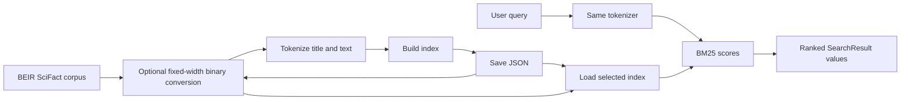

# StrataJanus-IR

**StrataJanus-IR** is a small educational search engine for exploring lexical
information retrieval. Its implemented search path uses SciFact documents, a
versioned tokenizer, saved JSON or fixed-width binary inverted indexes, and
BM25 ranking.

## Current capabilities

- Download and validate the BEIR-format SciFact dataset.
- Convert source records into normalized JSONL and TSV files with a manifest
  and stable document ID mapping.
- Normalize and tokenize text consistently for indexing and queries.
- Build and save a JSON index or convert it to fixed-width binary, then rank
  matching documents with BM25.
- Search processed SciFact from the command line.

The index is loaded into memory for each search. The project does not yet
implement benchmark metric evaluation, learning-to-rank, dense or hybrid
retrieval, RAG, or financial signal extraction. Those are possible future
directions, not current search features.

## Retrieval pipeline



The prepared records retain their external SciFact `doc_id`. During index
construction each document also receives a zero-based internal ID based on
input order. Postings and document lengths use internal IDs; search results
include both identifiers so the CLI can look up and display source documents.
See the [architecture](architecture.md) and [indexing](indexing.md) pages for
the data flow and structures.

## Repository map

| Path | Purpose |
| --- | --- |
| `src/stratajanus/text/tokenizer.py` | Versioned normalization and token extraction |
| `src/stratajanus/index/inverted.py` | In-memory postings and index builder |
| `src/stratajanus/retrieval/bm25.py` | BM25 scoring and search results |
| `scripts/download_scifact.py` | Download source dataset |
| `scripts/load_scifact.py` | Search the saved JSON index |
| `scripts/prepare_scifact.py` | Validate and convert raw SciFact files |
| `scripts/index_scifact.py` | Build and validate the in-memory index |
| `scripts/build_scifact_index.py` | Build and save the SciFact index |
| `scripts/search_scifact.py` | Search using either saved index format |
| `scripts/convert_index_to_binary.py` | Convert JSON index to fixed-width binary |
| `tests/` | Tokenizer, index, BM25, and data preparation tests |
| `docs/` | MkDocs documentation pages |

## Install and run

Use Python 3.13 or newer, as specified by `pyproject.toml`. From the repository
root:

```bash
python3.13 -m venv .venv
source .venv/bin/activate
python -m pip install --upgrade pip
python -m pip install -e .
python -m pip install -r requirements.txt
```

The editable install installs the `stratajanus` package. `requirements.txt`
provides the pinned development, SciFact, test, and MkDocs tools.

Run the test suite:

```bash
python -m pytest
```

Download and prepare SciFact, build the saved index once, then search it:

```bash
python scripts/download_scifact.py
python scripts/prepare_scifact.py
python scripts/build_scifact_index.py
python scripts/search_scifact.py "evidence for a scientific claim" --format json --top-k 10
```

The download and preparation commands create data under ignored `data/`
directories. The build and conversion commands refuse to overwrite existing
index directories. To create and search the binary variant:

```bash
python scripts/convert_index_to_binary.py
python scripts/search_scifact.py "evidence for a scientific claim" --format fixed32
```

`search_scifact.py` defaults to JSON. `load_scifact.py` remains a JSON-only
search command. See [Index Storage](index_storage.md) for the file layouts.

Preview the documentation locally with:

```bash
mkdocs serve
```

The [API reference](api.md) documents the package and dataset scripts.
