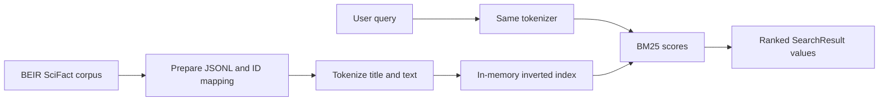

# StrataJanus-IR

**StrataJanus-IR** is a small educational search engine for exploring lexical
information retrieval. Its implemented search path uses SciFact documents, a
versioned tokenizer, an in-memory inverted index, and BM25 ranking.

## Current capabilities

- Download and validate the BEIR-format SciFact dataset.
- Convert source records into normalized JSONL and TSV files with a manifest
  and stable document ID mapping.
- Normalize and tokenize text consistently for indexing and queries.
- Build an in-memory inverted index and rank matching documents with BM25.
- Search processed SciFact from the command line.

The current index is rebuilt in memory and is not persisted. The project does
not yet implement benchmark metric evaluation, learning-to-rank, dense or
hybrid retrieval, RAG, or financial signal extraction. Those are possible
future directions, not current search features.

## Retrieval pipeline



The prepared records retain their external SciFact `doc_id`. During index
construction each document also receives a zero-based internal ID based on
input order. Postings and document lengths use internal IDs; search results
include both identifiers so the CLI can look up and display source documents.
See the [architecture](architecture.md) and [indexing](indexing.md) pages for
the data flow and structures.

## Repository map

| Path | Purpose |
| --- | --- |
| `src/stratajanus/text/tokenizer.py` | Versioned normalization and token extraction |
| `src/stratajanus/index/inverted.py` | In-memory postings and index builder |
| `src/stratajanus/retrieval/bm25.py` | BM25 scoring and search results |
| `scripts/download_scifact.py` | Download source dataset |
| `scripts/load_scifact.py` | Check BEIR dataset splits and references |
| `scripts/prepare_scifact.py` | Validate and convert raw SciFact files |
| `scripts/index_scifact.py` | Build and validate the in-memory index |
| `scripts/search_scifact.py` | Run a BM25 query against processed SciFact |
| `tests/` | Tokenizer, index, BM25, and data preparation tests |
| `docs/` | MkDocs documentation pages |

## Install and run

Use Python 3.13 or newer, as specified by `pyproject.toml`. From the repository
root:

```bash
python3.13 -m venv .venv
source .venv/bin/activate
python -m pip install --upgrade pip
python -m pip install -e .
python -m pip install -r requirements.txt
```

The editable install installs the `stratajanus` package. `requirements.txt`
provides the pinned development, SciFact, test, and MkDocs tools.

Run the test suite:

```bash
python -m pytest
```

Download and prepare SciFact, then build the in-memory index and search it:

```bash
python scripts/download_scifact.py
python scripts/prepare_scifact.py
python scripts/index_scifact.py
python scripts/search_scifact.py "evidence for a scientific claim" --top-k 10
```

The download and preparation commands create data under ignored `data/`
directories. `index_scifact.py` validates an in-memory build; it does not
write an index artifact. `search_scifact.py` independently loads the processed
documents and rebuilds the index for each invocation.

Preview the documentation locally with:

```bash
mkdocs serve
```

The [API reference](api.md) documents the package and dataset scripts.
