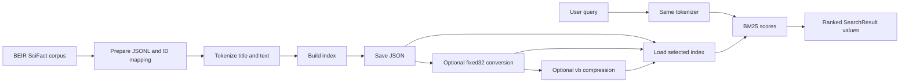

# StrataJanus-IR

**StrataJanus-IR** is a small educational search engine for exploring lexical
information retrieval. Its implemented search path uses SciFact documents, a
versioned tokenizer, saved JSON or fixed-width binary inverted indexes, and
BM25 ranking.

## Current capabilities

- Download and validate the BEIR-format SciFact dataset.
- Convert source records into canonical JSONL and TSV files with a manifest
  and stable document ID mapping.
- Normalize and tokenize text consistently for indexing and queries.
- Build and save a JSON index, convert it to fixed-width binary, or encode
  compressed postings, then rank matching documents with BM25.
- Search processed SciFact from the command line.
- Suggest indexed SciFact vocabulary terms from a prefix using autocomplete.

The index is loaded into memory for each search. The project includes SciFact
retrieval-quality evaluation, an initial SciFact performance benchmark, and a
completed Wikipedia scalability study at 10,000, 50,000, and 100,000
documents. See
[Wikipedia scalability](benchmarks/wikipedia.md) for its workflow, results,
and measurement boundaries. Learning-to-rank, dense or hybrid retrieval, and
RAG remain future directions.

## Retrieval pipeline



The prepared records retain their external SciFact `doc_id`. During index
construction each document also receives a zero-based internal ID based on
input order. Postings and document lengths use internal IDs; search results
include both identifiers so the CLI can look up and display source documents.
See the [architecture](architecture.md) and [indexing](indexing.md) pages for
the data flow and structures.

## Repository map

| Path | Purpose |
| --- | --- |
| `src/stratajanus/text/tokenizer.py` | Versioned normalization and token extraction |
| `src/stratajanus/index/inverted.py` | In-memory postings and index builder |
| `src/stratajanus/retrieval/bm25.py` | BM25 scoring and search results |
| `src/stratajanus/retrieval/autocomplete.py` | Trie, sorted-list, and optional marisa-trie vocabulary autocomplete |
| `scripts/download_scifact.py` | Download source dataset |
| `scripts/load_scifact.py` | Search the saved JSON index |
| `scripts/prepare_scifact.py` | Validate and convert raw SciFact files |
| `scripts/index_scifact.py` | Build and validate the in-memory index |
| `scripts/build_scifact_index.py` | Build and save the SciFact index |
| `scripts/search_scifact.py` | Search using any saved index format |
| `scripts/convert_index_to_binary.py` | Convert JSON index to fixed-width binary |
| `scripts/compress_scifact_index.py` | Create and verify compressed postings |
| `scripts/benchmark_scifact.py` | Benchmark SciFact construction, storage, loading, and queries |
| `scripts/prepare_wikipedia_subsets.py` | Prepare fingerprinted, nested Wikipedia JSONL subsets |
| `scripts/benchmark_scalability.py` | Benchmark Wikipedia index construction, storage, loading, and queries |
| `scripts/autocomplete_scifact.py` | Suggest terms from the saved SciFact vocabulary |
| `scripts/benchmark_autocomplete.py` | Compare autocomplete backends on a SciFact prefix workload |
| `scripts/create_scifact_validation_split.py` | Create a fixed validation split from training qrels |
| `scripts/evaluate_scifact.py` | Evaluate BM25 against SciFact relevance judgments |
| `tests/` | Tokenizer, index, BM25, autocomplete, evaluation, and data-preparation tests |
| `docs/` | MkDocs documentation pages |

The `vb` conversion expects the fixed32 index to exist first.
`search_scifact.py` accepts `--format json`, `--format fixed32`, or
`--format vb`; each loader reconstructs the complete index in memory.

## Install and run

`pyproject.toml` declares Python 3.13 or newer; Python 3.14 is the version
used for development and testing, and other versions have not been verified.
From the repository root:

```bash
python3.14 -m venv .venv
source .venv/bin/activate
python -m pip install -e .
python -m pip install -r requirements.txt
```

The package modules use the standard library; `requirements.txt` provides
pinned dependencies for the SciFact scripts, tests, and MkDocs tools.

Run the test suite:

```bash
python -m pytest
```

Download and prepare SciFact, build the saved index once, then search it:

```bash
python scripts/download_scifact.py
python scripts/prepare_scifact.py
python scripts/build_scifact_index.py
python scripts/search_scifact.py "evidence for a scientific claim" --format json --top-k 10
```

The download and preparation commands create data under ignored `data/`
directories. The build and conversion commands refuse to overwrite existing
index directories. To create and search the binary variant:

```bash
python scripts/convert_index_to_binary.py
python scripts/search_scifact.py "evidence for a scientific claim" --format fixed32
```

To create and search the compressed-postings index, first create the fixed32
index as above, then run:

```bash
python scripts/compress_scifact_index.py
python scripts/search_scifact.py "evidence for a scientific claim" --format vb
```

The compressed loader expands every posting list into the same in-memory index
used by the other formats; document lengths remain fixed-width.

`search_scifact.py` defaults to JSON. `load_scifact.py` remains a JSON-only
search command. See [Index Storage](index_storage.md) for the file layouts.

Preview the documentation locally with:

```bash
mkdocs serve
```

Build with strict warning checks using `mkdocs build --strict`.

The [API reference](api.md) documents the package and dataset scripts.

## Benchmark

With processed SciFact data available, write a benchmark report to a path that
does not already exist:

```bash
python scripts/benchmark_scifact.py --output reports/benchmarks/my-run.json
```

The script refuses to overwrite an existing report. See
[Performance benchmarks](benchmarks/scifact.md) for the protocol and report
summaries.

## Retrieval evaluation

BM25 parameter selection uses the fixed SciFact validation-query split. See
[Retrieval evaluation](retrieval-evaluation.md) for the frozen grid, decision
rule, validation comparison against the defaults, and retained reports.
Official test judgments were not used for parameter selection.
